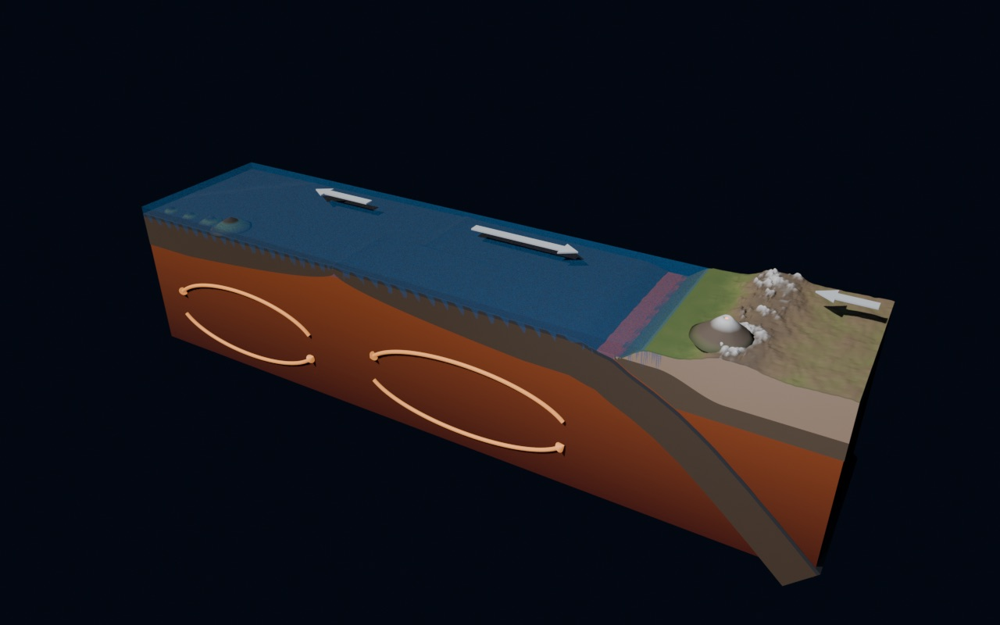

# Platten in Bewegung – Plattentektonik in 3D

Interaktive 3D-Animation (Blender → Three.js) für den Erdkundeunterricht (Sek. I/II): vom Schalenbau der Erde im Globus-Schnitt hinab in ein Blockbild, in dem sich die Platten wirklich bewegen. Mittelozeanischer Rücken mit wandernden Magnetstreifen, Transformstörung, Subduktion mit Erdbebenherden, Vulkanausbruch in den Anden, Hotspot mit Inselkette und Konvektionsströme im Mantel. Mit klickbaren Begriffen, Live-Werten, Phasen-Erklärungen und stufenlosem Zoom. Optimiert für Desktop, Tablet und Handy. LMG TECH.



## Online

https://simon23-12.github.io/BLENDERtektonik/

Jeder Push auf `main` veröffentlicht den Ordner `web/` automatisch über GitHub Pages – ohne Build-Schritt, ohne npm.

## Lokal ansehen

```bash
node serve.mjs
```

Dann http://127.0.0.1:5173 öffnen (kein `npm install` nötig; Three.js kommt per Import-Map von jsDelivr).

## Bedienung

- **Begriffe** anklicken/antippen oder aus der Liste wählen → Infotext, Fakten und Live-Werte (z. B. Alter des Gesteins an der Markierung, letztes Beben mit Herdtiefe).
- **‹ ›** bzw. Pfeiltasten ← → springen zwischen den 9 Phasen, Leertaste = Pause.
- **Magnetik** färbt den Ozeanboden nach seiner magnetischen Polung, **Wasser** blendet das Meer aus, **Konvektion** die Mantelströmung.

## Die Phasen

1. Schalenbau der Erde (Globus mit Achtel-Ausschnitt, maßstäblich)
2. Lithosphäre und Asthenosphäre (Zoom an den Rand des Schnitts)
3. Konvektion im Mantel
4. Ozeanbodenspreizung am Rücken
5. Subduktion am Tiefseegraben
6. Vulkanismus an der Subduktionszone
7. Starkbeben
8. Hotspot und Inselkette
9. Transformstörung

## Das Modell

`blender/build_tektonik.py` erzeugt Globus und Blockbild prozedural (im offenen Blender ausführen). Schreibt `blender/tektonik.blend`, `web/models/tektonik.glb` (Meshopt-komprimiert) und `web/models/timeline.json`.

- Globus: Schalen mit echten Tiefen (Kruste, Lithosphäre 100 km, Asthenosphäre bis 250 km, Mantel, äußerer Kern ab 2.900 km, innerer Kern ab 5.150 km), Achtel per Boolean ausgeschnitten.
- Blockbild: schematisches Profil nach dem Vorbild Ostpazifischer Rücken – Nazca-Platte – Peru-Chile-Graben – Anden. 1 Einheit = 10 km, 1.800 × 400 km Fläche, 400 km tief. Relief (Meerestiefe, Gebirge) 5-fach überhöht, Schichtdicken unverzerrt. Meerestiefe wächst mit der Wurzel des Krustenalters, die ozeanische Lithosphäre wird vom Rücken weg dicker.
- Zeit: Die Animation zeigt die letzten 6 Mio. Jahre bei 5 cm/Jahr je Platte.
- Magnetstreifen: Ein Shader berechnet für jeden Punkt des Ozeanbodens, wann sein Gestein am Rücken entstanden ist, und färbt ihn nach der damaligen Polung. Grundlage ist die geomagnetische Polaritätszeitskala (vereinfacht, u. a. Brunhes, Jaramillo, Olduvai, Gauss, Gilbert). Am Ende der Animation liegt das heutige Muster vor.
- Inseln der Hotspot-Kette sind in Blender animiert (wachsen über dem Plume, driften mit der Platte, sinken ab). Erdbeben, Ausbrüche und Magmatröpfchen kommen als Ereignisliste aus `timeline.json` und werden im Browser dargestellt.

`web/` – statische Seite (Three.js per Import-Map, kein Build). `src/core.js` ist der gemeinsame Viewer der LMG-TECH-Modelle, `src/main.js` das Tektonik-Modell, Texte in `src/content.js`.

Vereinfachungen: Konvektion schematisch in zwei Zellen (Antrieb heute vor allem durch Plattenzug), Profil ist kein echter Querschnitt, Hotspot liegt näher am Rücken als Hawaii, Erdbeben sind exemplarisch verteilt.
